# Finance Dashboard

**A private personal finance dashboard that runs on your own machine.** It pulls
real transactions from your banks, cards and brokerage, shows where the money
goes, compares every budget with what households in your state actually spend,
ranks concrete ways to spend less, and plans a home purchase against the result.

No cloud, no account, no telemetry. One SQLite file, next to the code.

[](https://hanozpatel.github.io/finance-dashboard/)
[](https://codespaces.new/hanozpatel/finance-dashboard?quickstart=1)
[](https://github.com/hanozpatel/finance-dashboard/actions/workflows/ci.yml)
[](LICENSE)

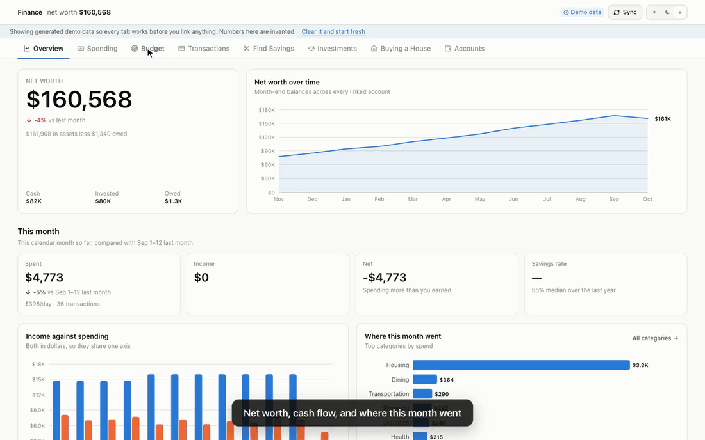

## Try it

Every screenshot and the preview use **made-up data** — a fictional person in San
Francisco. Nothing here is anyone's real finances.

| | | |
|---|---|---|
| **Look around** | [Live preview](https://hanozpatel.github.io/finance-dashboard/) | Instant, read-only, nothing to install |
| **Use it in your browser** | [Open in Codespaces](https://codespaces.new/hanozpatel/finance-dashboard?quickstart=1) | Your own private copy of the full app, ready in about two minutes |
| **Run it locally** | see below | Python 3.11+ and Node 20+ |

```bash
git clone https://github.com/hanozpatel/finance-dashboard.git
cd finance-dashboard
make install      # Python venv + npm packages
make env          # backend/.env with a freshly generated encryption key
make dev          # API on :8001, app on http://localhost:5174
```

The app starts with 18 months of realistic demo data so every tab works before
you link anything. One click clears it; [CONNECTING.md](CONNECTING.md) walks
through linking real accounts.

---

## What it does

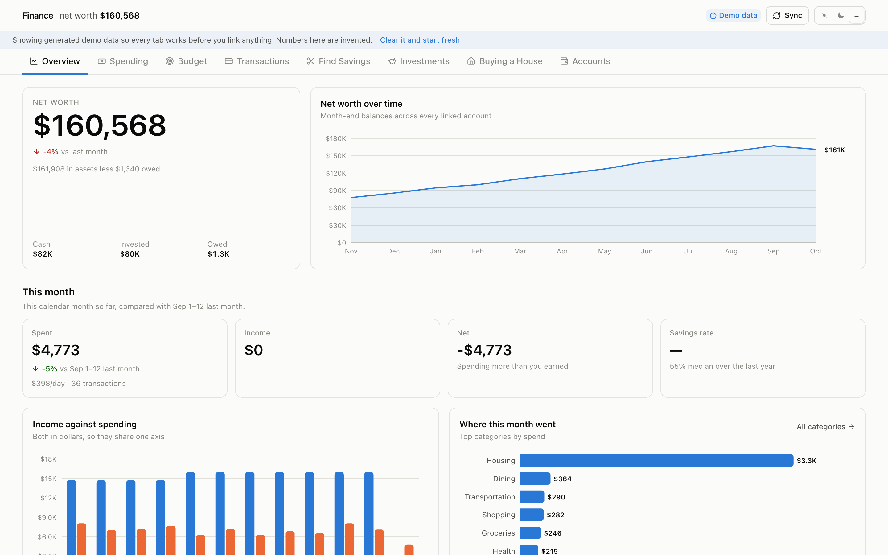

### Budgets, against what your state actually spends

Pick your state and household size, and every category shows your budget, your
spending, your typical month, and the state average — sourced from the U.S.
Bureau of Economic Analysis, with every line it uses listed. Twelve months sit in
a grid tinted by how each month compared. One click fills empty budgets with the
state average as a starting point.

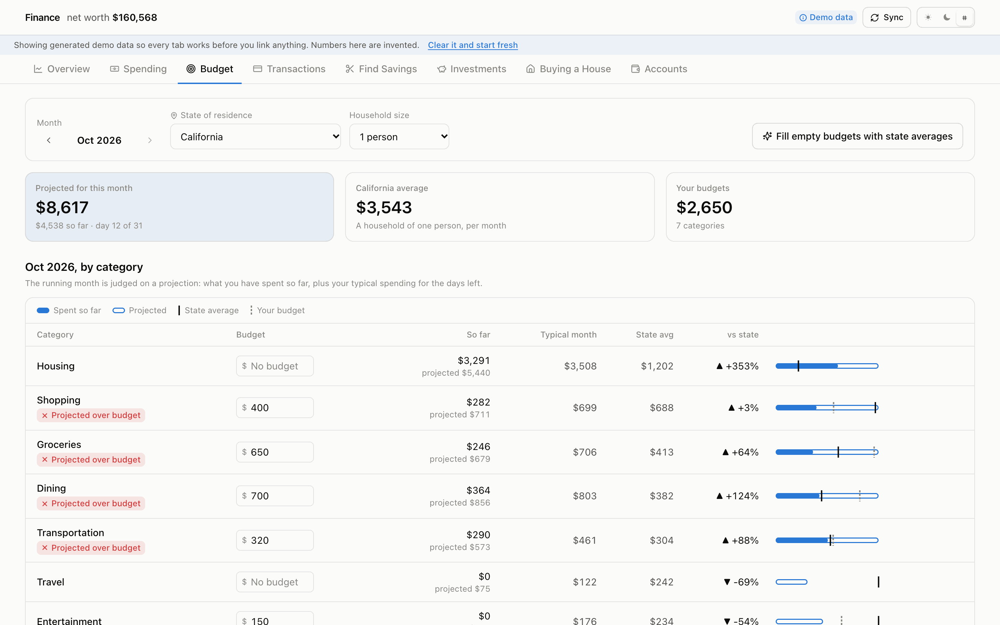
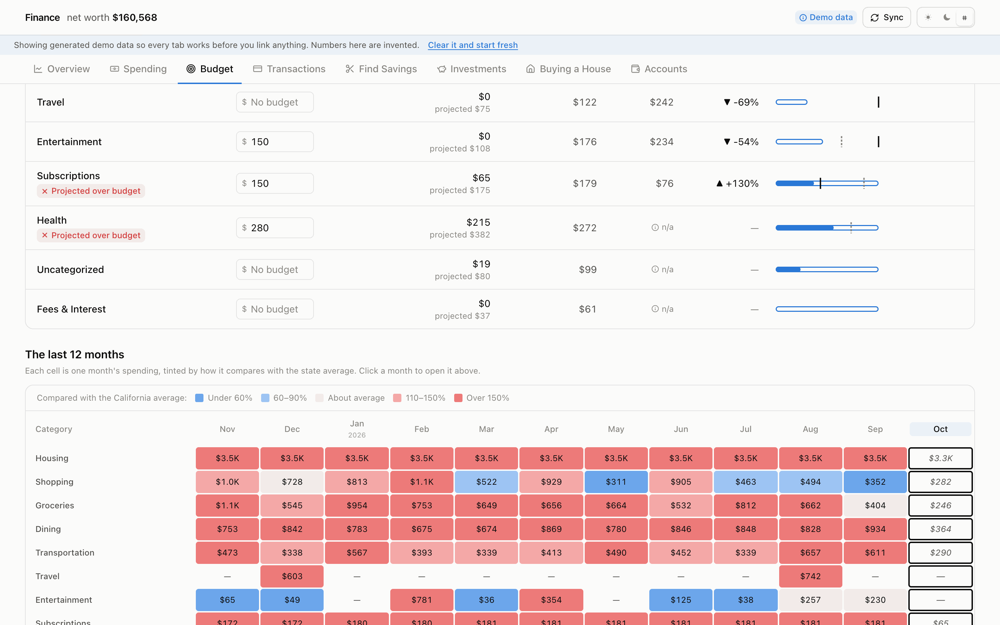

### It categorises what it can, and asks about the rest

Keyword rules, payment-processor signals and the provider's own taxonomy handle
most of a real feed. The local restaurant and the ACH bill with a mangled
company name are *asked* rather than guessed — once per merchant, biggest money
first, with suggestions that each say why they were offered. Every answer
becomes a rule, so the same question never comes back.

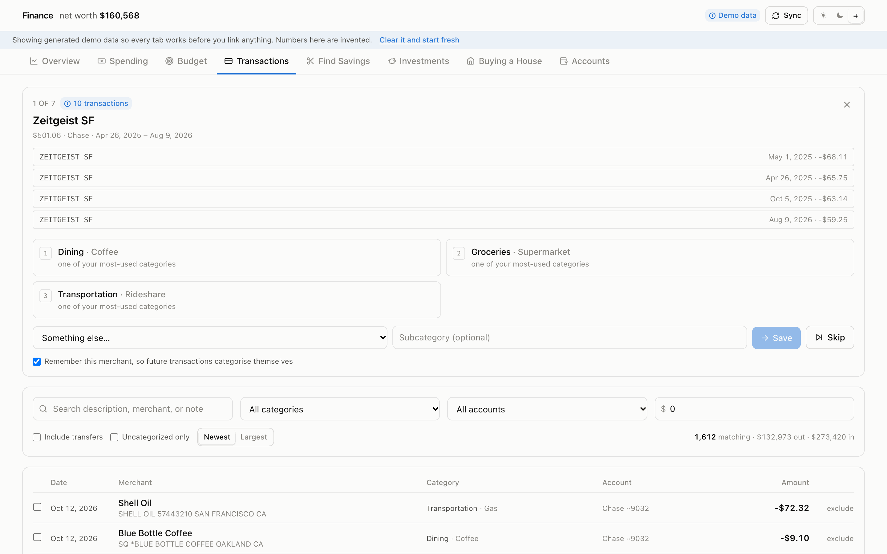

### Ranked savings, each with a dollar figure

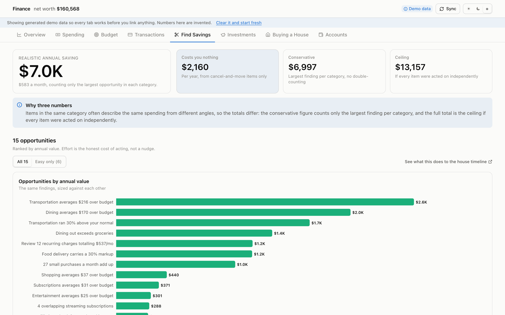

### A home-purchase plan built on the real numbers

State-specific property tax, insurance and closing costs; conventional, FHA, VA
and jumbo modelled separately; readiness, affordability, rent-vs-buy, and the
date the down payment will actually be there.

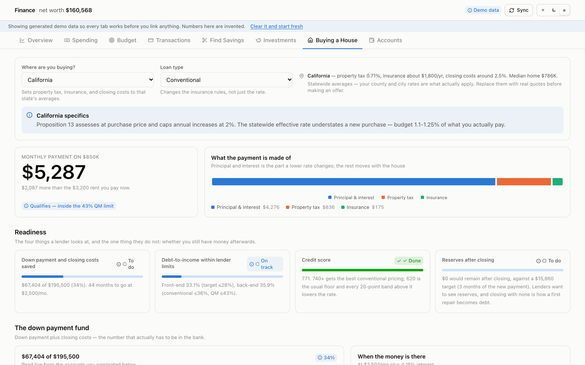

<details>
<summary>More: spending, investments, dark mode</summary>

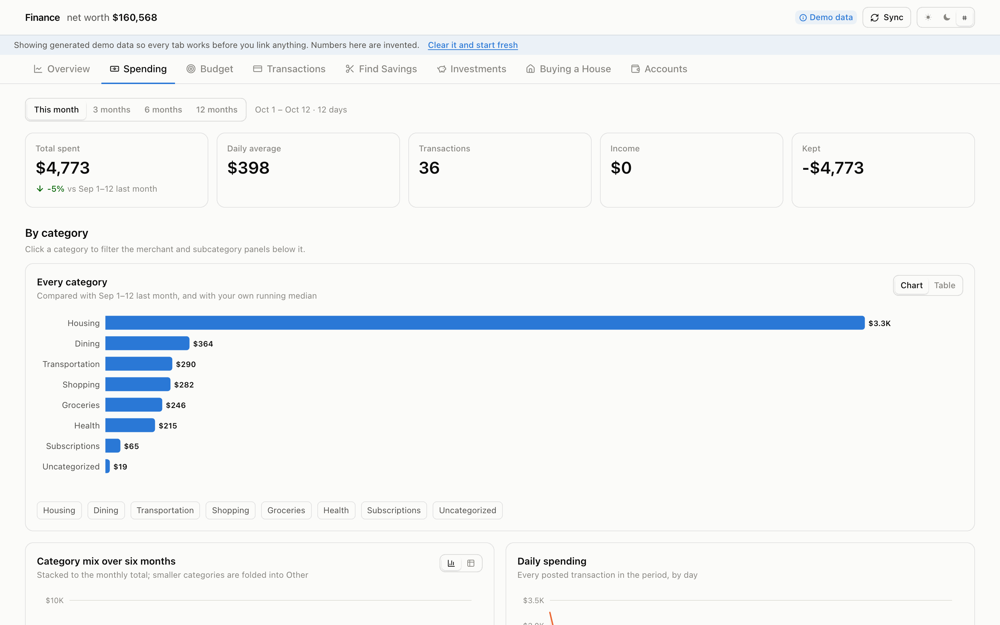
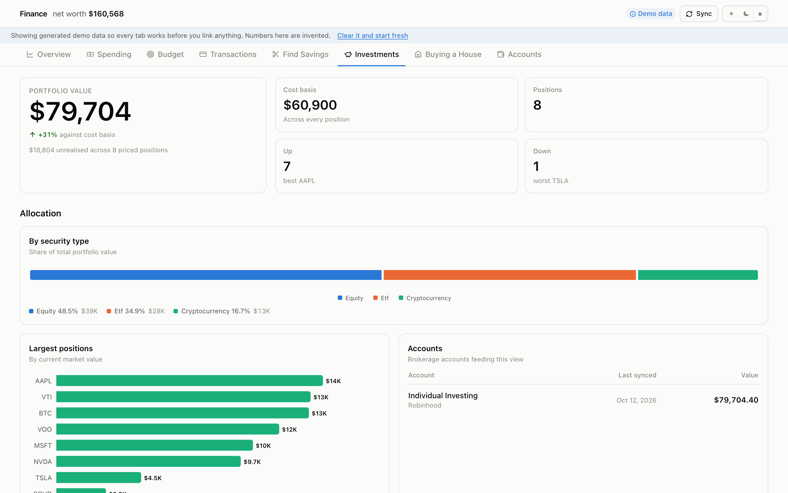
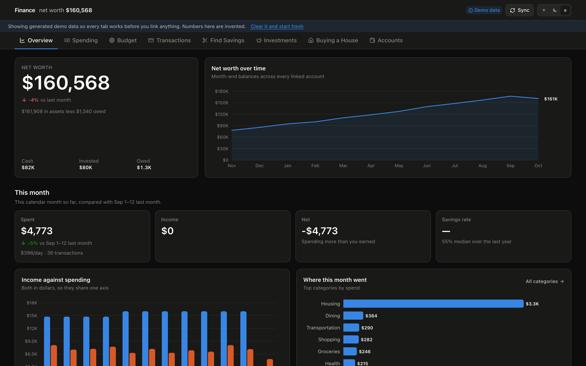
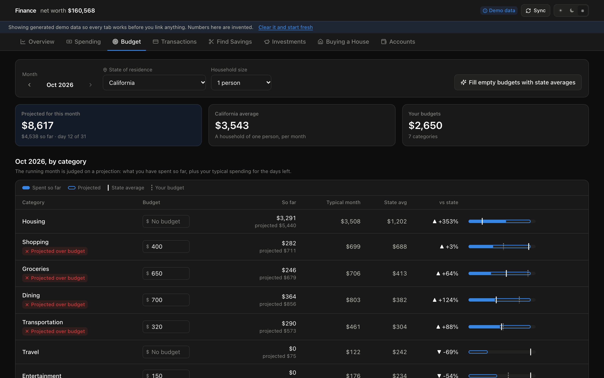

</details>

---

## Connecting your accounts

Step-by-step instructions are in **[CONNECTING.md](CONNECTING.md)**. In short:

| Your account | Route |
|---|---|
| Checking, savings, credit cards | **Plaid** — free Trial plan, 10 linked institutions |
| Brokerages (Robinhood, Fidelity, Schwab…) | **SnapTrade** — free Personal tier, read-only |
| Anything no aggregator reaches (Apple Card, Apple Savings) | **CSV import** or a manual account |

Both providers log you in on the institution's own page; your passwords never
pass through this app.

---

## Environment

| Variable | Required | Default | Purpose |
|---|---|---|---|
| `FINANCE_MASTER_KEY` | Strongly recommended | generated | Base64 32 bytes. Encrypts provider access tokens at rest with AES-256-GCM. **Unset → the key is generated and stored in the database, which a copied database file decrypts on its own.** The app warns in the header until it is set |
| `PLAID_CLIENT_ID` | For live data | — | From Team Settings → Keys |
| `PLAID_SECRET` | For live data | — | Match it to `PLAID_ENV` — the sandbox and production secrets differ |
| `PLAID_ENV` | No | `sandbox` | `sandbox` or `production` |
| `SNAPTRADE_CLIENT_ID` | For brokerages | — | From the SnapTrade dashboard |
| `SNAPTRADE_CONSUMER_KEY` | For brokerages | — | Secret; never sent to the browser |
| `SNAPTRADE_MODE` | No | inferred | `personal` or `commercial`; only needed if the client id prefix does not say |
| `FINANCE_DB_PATH` | No | `backend/finance.db` | Where everything is stored |
| `VITE_API_BASE_URL` | No | `""` | Empty in dev; Vite proxies `/api` to the backend |
| `BACKEND_PORT` / `FRONTEND_PORT` | No | `8001` / `5174` | Set in an untracked `local.mk` to run a second copy alongside the first |

`make env` creates `backend/.env` from the example with a freshly generated master key, and never
overwrites an existing one. To generate a key by hand:

```bash
python3 -c "import os,base64;print(base64.b64encode(os.urandom(32)).decode())"
```

---


## The tabs

**Overview** — net worth and its trend, income against spending, this month's
totals, and where the money went.

**Spending** — category and subcategory breakdowns against the previous period
and your own running median, six-month category mix, daily spend, and merchant
totals grouped across name variations. Every chart has a table view.

**Budget** — each month, each category: your budget, your spending, your typical
month, and the average for a household your size in your state.

**Transactions** — the full ledger with search and filters, the review queue for
anything uncategorised, and bulk recategorisation that can write a standing rule.

**Find Savings** — ranked, quantified opportunities, each with the effort it
takes and the assumption behind the estimate.

**Investments** — holdings, allocation, and return across positions that report a
cost basis.

**Buying a House** — state defaults, loan programs, readiness, down-payment
tracker, affordability, DTI, amortisation, rent-vs-buy, and a mortgage
calculator.

**Accounts** — linking, CSV import, manual accounts, and categorisation rules.

---

## How the numbers are defined

Three conventions, applied at the ingestion boundary so no query downstream
needs a provider-specific branch.

**Transaction amounts are negative when money leaves you**, on every account
type. A card purchase is negative even though it increases a balance owed,
because for spend analysis the only question is which direction the money went.

**Account balances are signed by net-worth contribution.** Assets positive,
liabilities negative. A card with $1,840 owed is stored as `-1840.00`, so net
worth is a plain `SUM` with no type switch.

**Spending has exactly one definition**, used by every query:

```sql
spend = -SUM(amount)  WHERE is_transfer = 0 AND excluded = 0 AND category != 'Income'
```

So: transfers are excluded, and paying a credit card from checking is not
counted as spending twice. Refunds are *netted* rather than ignored, which is
what makes "you spent $340 at Nordstrom" true after a return. Income is measured
separately rather than as negative spend, so the savings rate is a real ratio.

### State spending benchmarks

The Budget tab compares each category with what households in your state spend,
using the U.S. Bureau of Economic Analysis's *Personal Consumption Expenditures by
State* (table SAPCE4, 2025). BEA publishes spending by state and by function; the
build script divides each line by the state's population (derived from BEA's own
totals and cross-checked against a published per-capita line), groups lines into
the app's categories, and the app scales the result to a month and to your
household size.

Three decisions keep the comparison honest:

- **Only categories with a cash-like counterpart are compared.** Health is
  excluded on purpose: BEA counts what insurers, Medicare and Medicaid pay for
  care, so out-of-pocket card spending would always look tiny beside it. Interest,
  taxes and gifts are not consumption at all.
- **Housing includes owners' imputed rent**, which makes it a fair yardstick for
  renters and owners alike.
- **The running month is judged on a projection** — spent so far plus your
  typical rate for the days left — not straight-line pace, which turns one big
  early grocery run into an absurd month.

Every BEA line behind every category is listed in the app and in
`backend/scripts/build_state_benchmarks.py`, which checks line codes *and*
descriptions so a renumbered BEA table stops the build instead of silently
comparing groceries to something else. Re-run it when BEA publishes a new year:

```bash
curl -LO https://apps.bea.gov/regional/zip/SAPCE.zip
python backend/scripts/build_state_benchmarks.py SAPCE.zip
```

### Comparison windows

A month-to-date range is compared against **the same days of the previous
month**, not the immediately preceding N days. The naive trailing window
straddles the month boundary and excludes rent, which lands on the 1st — on the
12th of the month that reported a 465% spending increase that was entirely an
artefact of where the window was cut. `tests/test_analytics.py` pins this.

### Merchant grouping

The same coffee shop arrives as `SQ *BLUE BOTTLE COFFEE  OAKLAND CA`,
`TST* BLUE BOTTLE #4412`, and `BLUE BOTTLE COFFEE 0041`. Nothing works until
those collapse to one key, so normalisation strips processor prefixes, bank
ceremony, store numbers, order ids, and a trailing `CITY ST` block.

Cities are removed only on an exact match against a list. The tempting shortcut
— "drop one token before the state code" — mangles real names: `OR ELSE CAFE NY`
would become `OR ELSE`. An unknown small city staying in the key costs a little
cross-city grouping; a mangled merchant name costs correctness.

### Recurring detection

A merchant charging a similar amount at a regular interval **at least three
times** is a recurring series. Two points define an interval but not a pattern,
and acting on a two-point "subscription" means telling you to cancel something
you bought twice by coincidence.

Confidence blends interval regularity, amount stability, and occurrence count. A
usage-based bill like electricity is correctly detected as recurring but scores
lower than a flat subscription, because the amount moves.

### Savings estimates

Every finding must produce a dollar figure, or it is not emitted — an
unquantified suggestion cannot be ranked, and so cannot be acted on in order.
Each carries its `basis`, the assumption behind the number, so a figure you
disagree with can be argued with rather than just distrusted.

Three totals are reported rather than one, because several findings can describe
the same restaurant bill from different angles:

- **Easy** — cancel-and-move items only, no change to how you live.
- **Conservative** — the largest finding per category, avoiding double-counting.
- **Ceiling** — the plain sum, if every item were acted on independently.

Budget overages are measured against **three complete months**, not the current
month prorated. On the 12th, two early charges extrapolate into a four-figure
annual claim that outranks every real finding.

### Mortgage math

Pure functions over plain numbers in `services/mortgage.py`, checked in
`tests/test_mortgage.py` against published figures rather than against
themselves.

- Level P&I from the standard amortisation formula; $500,000 at 6.5% over 30
  years is $3,160.34.
- **PMI** is charged above 80% LTV, may be *requested* away at 80%, and
  terminates automatically at 78% of the original value. Both months are
  reported, because the difference is real money.
- **DTI** front-end (housing ÷ gross) and back-end (all debt ÷ gross), against
  the 28/36 conventional target, the 43% Qualified Mortgage ceiling, and the
  ~50% wall.
- **Affordability** solves in closed form rather than bisecting, and reports
  both ceilings — what your income supports and what your cash supports —
  because the lower one is the real budget.
- **Rent vs buy** credits the renter with investing the cash a buyer sinks into
  the down payment and closing costs, plus any monthly difference. That
  opportunity cost is the single biggest reason a naive "rent is throwing money
  away" comparison misleads. The buyer is credited with the mortgage-interest
  and property-tax deduction, but only above the standard deduction and with
  property tax capped at the $10,000 SALT limit.

### Loan programs

Conventional, FHA, VA, and jumbo are modelled separately, because the
differences change the answer rather than just the rate:

- **Conventional** — PMI above 80% LTV, terminating automatically at 78%.
- **FHA** — a 1.75% upfront premium financed *into* the loan, so you borrow more
  than the price less the down payment. The annual premium is often *lower* than
  conventional PMI, and below 10% down it **never terminates** — on a $600K house
  at 5% down that is roughly $87,000 of insurance against $35,000 conventional.
  The comparison table exists to make that visible.
- **VA** — no mortgage insurance at any down payment, in exchange for a one-off
  funding fee (2.15% first use at zero down, less with a down payment, waived
  with a service-connected disability rating).
- **Jumbo** — above the conforming limit, no PMI, stricter down payment and
  reserves.

Eligibility problems are reported as warnings rather than refusals: being told
*why* a 1% down FHA loan does not exist is more useful than a blank screen.

The conforming limit defaults to the 2025 baseline of $806,500 and is editable,
since high-cost counties are higher and it is raised most years.

### State defaults

Property tax varies by more than a factor of seven across the country — 0.29% in
Hawaii against 2.23% in New Jersey — which on an $800,000 house is about $1,300
a month. Choosing a state fills in property tax, homeowners insurance, and
closing costs from that state's averages, and nothing else: price, income, rate,
and down payment are your situation, not the state's.

Those figures are **starting estimates, not quotes**. County and city rates are
what actually apply, and inside Texas, Illinois, and New York the spread within
the state exceeds the spread between states. California is called out
separately: Proposition 13 assesses at purchase price, so the statewide
effective rate understates what a new buyer pays.

The house tab is connected to the savings tab: the monthly figure the analysis
identifies is converted into months off the down-payment timeline. A spending
insight nobody acts on is trivia; tying it to a date makes it a decision.

---

## Privacy and security

- One SQLite file on your machine. No cloud, no telemetry, no analytics.
- The API binds to localhost and allows only local origins.
- Provider access tokens are encrypted with AES-256-GCM before they touch the
  database. A Plaid token reads every transaction on your card and every
  position in your brokerage — encrypting it means a copied database file is
  not by itself enough.
- Pending CSV uploads are raw statements; any not committed within six hours are
  deleted.
- `.gitignore` excludes the database, `.env`, uploads, and certificates.

---


## How it is hosted

There is no shared server, on purpose: a finance app that stores everyone's data
in one place is a different and much riskier product.

- **The live preview** is a static build on GitHub Pages. A
  [workflow](.github/workflows/pages.yml) seeds a throwaway database with the
  made-up demo data, records every response the interface can ask for
  ([`build_static_demo.py`](backend/scripts/build_static_demo.py)), and the browser
  answers from that file. Searching and filtering transactions runs in the browser
  against the full demo ledger. It rebuilds daily so its "this month" matches
  yours. Edits are refused with a pointer to the full app.
- **Codespaces** runs the real app in a private container for whoever opens it,
  configured by [`.devcontainer/`](.devcontainer/devcontainer.json): dependencies
  install, an encryption key is generated, demo data loads, and the app opens.
  Nothing is shared between visitors.
- **Locally** it is two processes on localhost.

---

## Development

```bash
make test          # 218 backend tests
make dev           # API + app together
make backend       # API only
make frontend      # app only
make build         # production bundle (type-checks first)
make preview       # build the static GitHub Pages preview into frontend/dist-preview
```

To run a second checkout alongside the first, put different ports in an
untracked `local.mk`:

```make
BACKEND_PORT = 8002
FRONTEND_PORT = 5175
```

```
backend/
  db.py                     schema, connections, the sign conventions
  data/state_benchmarks.json  BEA spending per person, by state and category
  scripts/
    build_state_benchmarks.py rebuild the benchmarks from BEA's release
    build_static_demo.py      snapshot the demo for the static preview
  services/
    benchmarks.py           state averages, household scaling, your settings
    budgeting.py            the Budget tab: budget vs spend vs state
    mortgage.py             pure mortgage/affordability/rent-vs-buy math
    analytics.py            spend definition, breakdowns, comparison windows
    categorize.py           merchant normalisation + categorisation
    review.py               the uncategorised-transaction review queue
    recurring.py            subscription detection
    insights.py             ranked savings opportunities
    goals.py                the house plan
    states.py               per-state tax, insurance, and closing-cost defaults
    plaid_service.py        banks and cards
    snaptrade_service.py    brokerages
    csv_service.py          CSV import, Apple Card included
    sync_service.py         the only writer of transactions
    crypto_service.py       AES-256-GCM for tokens
    seed.py                 deterministic demo data
  routers/                  FastAPI endpoints
  tests/                    218 tests

frontend/src/
  components/charts.tsx     every chart, with the mark specs applied once
  components/ui.tsx         cards, stat tiles, meters, tables, badges
  lib/demo.ts               the static preview's in-browser "backend"
  pages/                    one file per tab
```

The demo dataset is deliberately unflattering — overlapping streaming services, a
delivery habit, two subscriptions that quietly raised their price, cash idling in
a 0.01% checking account, and a few local merchants the categoriser cannot place.
Those are exactly the situations the app exists to catch, so the seed doubles as
an end-to-end check on it.

### Troubleshooting

**"Could not reach the backend"** — the API is on **8001**, not 8000, so it
cannot collide with anything already running. Check `make backend`.

**A newly linked bank shows only a month of history** — Plaid returns recent
transactions immediately and backfills the rest in the background. With no
webhook available on a laptop, pressing Sync again is how the app collects it;
the full two years lands in one go.

**A brokerage links but has no holdings** — a brokerage linked through Plaid's
bank button can never return holdings, because a Plaid Item's products are fixed
at creation. Disconnect it and use **Connect a brokerage** (SnapTrade) instead.

**A CSV imported with inverted signs** — the preview shows the parsed result
before anything is written, and purchases must appear as negative amounts. Flip
the sign convention there and re-import; duplicates are skipped, so nothing is
double-counted.

**Charts animate when you'd rather they didn't** — they honour
`prefers-reduced-motion`.

**The demo data came back** — it shouldn't. Clearing sets a marker that
suppresses re-seeding. If you deleted `finance.db` outright (`make clean`) that
marker went with it, and the next start is a first run again.

---

## License

[MIT](LICENSE).
